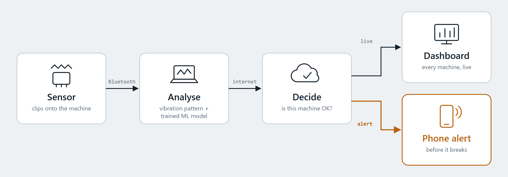

# MachineGuard by SmolBugs

**An easy to install monitor that learns what a machine is like when it's healthy, and alerts your phone when its vibration or temperature drifts away from that, before the machine breaks.**

natHacks 2026, Standard Division, Construction and Manufacturing theme.

**Live dashboard:** https://sm-db6bb08ece0d477c9e820f118f7e670c.ecs.ca-central-1.on.aws (the real drill is `MG-001`; it shows *No signal* when the sensor isn't running)



## The problem

Small shops run drills, saws and lathes until they fail: in Canada, 19% of businesses say they run equipment until it fails (ABB "Value of Reliability" survey, 2023). Condition monitoring exists, but it's sold to large plants with reliability engineers (for example Nanoprecise, Augury and SKF). A shop with no maintenance team finds out when the tool stops, the part is ruined or someone gets hurt.

## What MachineGuard does

1. A sensor node clips onto the machine and measures vibration (about 1,600 samples per second) and temperature.
2. It sends full vibration windows over Bluetooth to a gateway laptop.
3. The gateway runs an FFT on each window (vibration level in mm/s and its main frequency), and a trained model compares the window with that machine's own healthy baseline, learned in the first ~30 s after the sensor is clipped on.
4. The cloud decides whether the machine is off, running normally or vibrating far above normal, stores everything, and shows it on a live dashboard. When a machine goes abnormal, the dashboard turns red with a suggested check and a **phone alert** goes out; when it recovers, a second alert says so.

```text
Heltec ESP32 + LSM303D accelerometer + thermistor (on the machine)
        │ Bluetooth Low Energy: status every 0.5 s, a 4,096-sample vibration window every 10 s
        ▼
Python receiver ──► reassemble vibration window ──► FFT metrics ──► ML detector
        │                                              │
        ├── save local session                         └──► cloud API (Next.js)
        └── upload status and window results                  │
                                                              ▼
                                                PostgreSQL ──► dashboard + phone alerts
```

The machine1 firmware sends thermistor status readings about twice per second and vibration windows in compact binary BLE packets. The receiver reconstructs each window, calculates frequency and severity metrics, and can save the session or queue uploads to the cloud. The cloud stores status packets and analysed windows, raises alerts, and serves the dashboard.

## Links

| What | Where |
|---|---|
| Live dashboard | https://sm-db6bb08ece0d477c9e820f118f7e670c.ecs.ca-central-1.on.aws |
| System diagram | [`docs/system-flow.png`](docs/system-flow.png) ([SVG](docs/system-flow.svg)) |
| Cloud packet formats | [`docs/sending-data.md`](docs/sending-data.md) |
| Repository | https://github.com/Divy-21/SmolBugs |

## Quick start: the real drill, end to end

On the gateway laptop, with the board powered and Bluetooth on (and **Bluetooth mice and headphones off**, see Troubleshooting):

```bash
python "hardware scripts/machine1/receiver.py"
```

The first time, it asks for the device key (the team shares it privately) and saves it in `smolbugs.env`, which git ignores. Then:

1. Run the drill normally, with no load, for about 40 s. The terminal shows `model: Learning this drill's normal (1 of 3)` up to `Learned`.
2. Open the live dashboard and click the drill (`MG-001`): it shows **Running**, the vibration in mm/s, and the model's answer.
3. Put a fault on the machine (for example a washer on the chuck) for 30 s: the tile turns red and the phone alert goes out. Remove it and run normally for 30 s: the alert closes.

Options: `--simulate` (fake board, uploads as `MG-SIM`), `--no-cloud`, `--relearn` (after moving the sensor), `--no-model`, `--duration 60`.

## Hardware requirements

| Part | Notes |
|---|---|
| Heltec WiFi LoRa 32 V3 (ESP32-S3) | Built-in 0.96 in OLED on the first I2C bus (`Wire`, GPIO17/18) |
| Pololu MinIMU-9 v3 | LSM303D accelerometer on the second I2C bus (`Wire1`, SDA GPIO2, SCL GPIO4). Starting `Wire` again on other pins is silently ignored by the ESP32, which is why it needs `Wire1`. |
| NTC thermistor | 3.3 V → 75 kΩ fixed resistor → GPIO1 → thermistor → ground |
| USB cable or LiPo battery | Power for the board |
| Laptop with Bluetooth | Runs the Python receiver (gateway) |

## Repository layout

| Path | Contents |
|---|---|
| [`hardware scripts/machine1/`](hardware%20scripts/machine1/) | ESP32 machine1 firmware and shared BLE packet protocol header |
| [`predictive-maintenance/processing/`](predictive-maintenance/processing/) | BLE protocol decoding, window assembly, FFT analysis, and thermistor conversion |
| [`predictive-maintenance/ingest/`](predictive-maintenance/ingest/) | BLE receiver, session recording, FFT report, and cloud uploader |
| [`predictive-maintenance/simulation/`](predictive-maintenance/simulation/) | Synthetic vibration, BLE device, and packet simulators |
| [`predictive-maintenance/ml/`](predictive-maintenance/ml/) | MachineGuard recording, training, live check, and bearing wear tracking |
| [`predictive-maintenance/tests/`](predictive-maintenance/tests/) | Python and firmware protocol tests |
| [`cloud/`](cloud/) | Next.js API service, Prisma/PostgreSQL schema, and dashboard |
| [`docs/sending-data.md`](docs/sending-data.md) | Cloud packet formats and sender examples |

## 1. Flash the firmware

`hardware scripts/machine1/machine1/` contains `machine1.ino` and `smolbugs_protocol.h`, which must stay in the same folder.

1. Open `machine1.ino` in the Arduino IDE.
2. Select the **Heltec WiFi LoRa 32 V3** board and its port.
3. Upload. The board advertises over Bluetooth as `MachineGuard`.

Settings near the top of the sketch:

| Setting | Default | Meaning |
|---|---|---|
| `VIB_INTERVAL_MS` | 10000 | Time between vibration windows |
| `VIB_FRAME_GAP_MS` | 10 | Pause between messages; lower is faster but risks drops |
| `VIB_WINDOW_SAMPLES` | 4096 | Readings per window (2.56 s at 1,600 Hz) |
| `VIB_RANGE_G` / `VIB_LSB_PER_G` | 4 / 8197 | Must match the LSM303D full-scale setting |

## 2. Set up the Python gateway

From `predictive-maintenance/`, create and activate a virtual environment, then install the dependencies:

```bash
python -m venv .venv
# macOS/Linux:
source .venv/bin/activate
# Windows PowerShell:
# .venv\Scripts\Activate.ps1
# (if you get "running scripts is disabled", run: Set-ExecutionPolicy -Scope Process -ExecutionPolicy Bypass)
python -m pip install numpy scipy pandas plotly pytest bleak scikit-learn==1.9.1 joblib
```

### Run the receiver

```bash
python -m ingest.ble_receiver --simulate                 # fake board, no hardware needed
python -m ingest.ble_receiver                            # real board
python -m ingest.ble_receiver --rpm 1200                 # also show 1x/2x/3x harmonics (drill at 1200 rpm)
python -m ingest.ble_receiver --rpm 1200 --out data/session1   # save readings and raw windows
python -m ingest.ble_receiver --duration 60              # run for 60 s, then stop
```

Example output:

```
Connected. MTU: 247
Temp  #   12 | 1582 mV |   69.06 kΩ |  33.57 °C
Vib   window     0 | dominant   20.00 Hz @ 0.050 g | velocity 1.12 mm/s | 1x=0.050 2x=0.010 3x=0.001
```

With `--out`, the folder gets `temperature.jsonl`, `vibration.jsonl` and a `windows/` folder of raw data (`.npz`). Press Ctrl+C to stop; a summary of anything lost or rejected is printed at the end.

### View the FFT

```bash
python -m ingest.fft_report data/session1 --rpm 1200
start data/session1/fft_report.html          # Windows; use "open" on macOS

# or keep the report updating live while recording:
python -m ingest.ble_receiver --rpm 1200 --out data/session1 --live-html
```

The report shows the raw vibration, the FFT amplitude spectrum with 1×/2×/3× running-speed lines, the Welch PSD, velocity RMS per window and temperature. Keep `plotly.min.js` next to `fft_report.html`.

To see a healthy machine and a faulty machine side by side without hardware:

```bash
python -m simulation.fft_demo
start smolbugs_fft_demo.html
```

### Send data to the cloud

Add `--cloud` to send every status reading and analysed window to the SmolBugs cloud. The address and key come from environment variables, so the key never goes into a file or into git:

```powershell
$env:CLOUD_URL  = "http://localhost:3100"      # or the deployed cloud URL
$env:DEVICE_KEY = "dev-key-change-me"          # the local key; ask the team for the deployed one
python -m ingest.ble_receiver --cloud --rpm 1200
python -m ingest.ble_receiver --cloud --simulate
```

Runs recorded without `--cloud` can be uploaded afterwards:

```bash
python -m ingest.upload_run data/raw
```

Uploads run in the background, retry with growing pauses if the internet drops, and keep about 10 minutes of backlog. Full details are in `predictive-maintenance/processing/README.md`.

## 3. Machine learning

Labels: `off`, `normal_free`, `normal_load`, `imbalance`, `bent_bit`, `loose_bit`, `overheat`.

**Record labelled runs** (one run per command; the run number is picked automatically):

```bash
python -m ml.record --session 1 --label normal_free --seconds 300
python -m ml.record --session 1 --label imbalance --seconds 300
python -m ml.record --session 1 --label normal_free --seconds 300 --cloud   # also uploads while recording
```

A session is one mounting of the sensor. Record `normal_free` first in every session (normal is learned from it), use at least 2 sessions (3 or more is better), and re-clip the sensor between sessions. 300 s gives about 30 Bluetooth windows (210 analysis windows).

**Train and test:**

```bash
python -m ml.train --raw data/raw --out models
python -m ml.live_check --raw data/raw --session 3
```

`train.py` always tests on a session it never trained on, never on a random split of windows, because windows from the same run look almost identical and would inflate the score. Add `--use-temp` once the thermistor is checked against a thermometer.

**How the detector decides** (each window):

1. Main axis much quieter than normal, or the classifier says `off`: **Machine off**.
2. Classifier says normal and the isolation forest agrees: **Running normally**.
3. Classifier names a fault with at least 60% confidence, and the isolation forest or the FFT rules agree: **Fault**, with a recommendation (for example "Tighten the chuck and check that the bit is seated all the way in." for a loose bit).
4. Anything else: **Unusual vibration, type unknown**.

Features are measured relative to each session's own `normal_free` runs, so the model works whether the sensor sits closer to or further from the chuck.

**Bearing wear tracker** (slow faults that build over days), checked on the Ball Bearing Run-to-Failure dataset (Kaggle, Jung et al. 2023), cut down to 1,600 Hz to match our sensor:

```bash
python -m ml.bearing_validation extract --zip "path/to/archive.zip"
python -m ml.bearing_validation analyze
```

The chart is saved to `reports/bearing_wear_warning.png`. Data and model files are generated locally and are not checked into the repository. Full details: [`predictive-maintenance/ml/README.md`](predictive-maintenance/ml/README.md).

**Live, in the receiver** ([`ingest/live_model.py`](predictive-maintenance/ingest/live_model.py)): when `models/machineguard.joblib` is on the gateway laptop, the receiver runs it on every vibration window. It learns the machine's normal from the first 3 windows of the motor running (it skips windows where the machine is off or being moved by hand), saves that baseline so a restart reuses it, judges the 7 analysis windows in each clip and sends the majority answer to the cloud with the window. The dashboard shows it ("Model: Running normally, 63% sure"). Phone alerts don't depend on the model: it was trained on one session, so it informs, and the measured vibration decides.

## 4. Cloud and dashboard

Requires Node.js 20 or later and Docker Desktop (running). Follow [`cloud/README.md`](cloud/README.md) for full details. In brief:

```bash
cd cloud
npm install                 # also generates the Prisma client
cp .env.example .env        # Windows cmd: copy .env.example .env
npm run db:up               # local Postgres in Docker, on port 5433
npm run db:migrate          # create the tables
npm run dev                 # http://localhost:3100
```

In a second terminal, try it without hardware:

```bash
npm run fake-device         # one simulated machine; press f to toggle a fault
npm run fake-fleet          # six simulated machines in different states
```

`fake-fleet` keys: `1` to `6` fault, `q` to `y` signal loss, `a` to `h` idle, `z` to `n` dead accelerometer. All of this data is simulated.

Look at the stored data with `npm run db:studio`, or `curl localhost:3100/api/v1/machines`.

**Dashboard** (`http://localhost:3100`): every machine is **Online**, **Idle** or **Offline** based on what the database has stored, and machines with an open alert are listed as **Broken** at the top. The selected machine shows temperature and vibration with limit lines, a 10-minute temperature trend, the latest FFT window, the alert history, and a monitoring panel (last reading, sensor health, readings waiting to be stored).

**Drill states** (from each vibration window, [`cloud/src/lib/runState.ts`](cloud/src/lib/runState.ts)): **Off** below 1 mm/s, **Being moved** when the main frequency is below 15 Hz (a person handling it, not the motor), **Running**, and **Vibration far above normal** above 30 mm/s.

**Alerts** ([`cloud/src/lib/stream.ts`](cloud/src/lib/stream.ts)):
- Twice-a-second status readings: 3 abnormal in a row (shock, vibration spread, temperature) open an alert, 6 normal close it.
- Vibration windows: 2 windows above 30 mm/s in a row open an alert, 2 normal close it.
- A frozen accelerometer (the same reading 5 times in a row, for example a loose wire stuck at full scale) is reported as a **sensor fault**, not as vibration.
- Every alert that opens or closes is pushed to phones through [ntfy](https://ntfy.sh) (`NTFY_TOPIC`, kept in AWS Secrets Manager).

Limits are environment variables (`TEMP_MAX_C`, `VIBRATION_STD_MAX_G`, and others), and `MG-001` (the real drill) has its own limits because a running drill shakes far more than an idle machine.

**Hosting:** the cloud runs on AWS (Amazon ECS Express Mode on Fargate, RDS PostgreSQL in a private subnet, image in ECR); [`cloud/deploy/aws-deploy.sh`](cloud/deploy/aws-deploy.sh) builds and deploys it. The device key and the ntfy topic live in AWS Secrets Manager, never in the repository.

API routes, authentication and packet formats are documented in [`cloud/README.md`](cloud/README.md) and [`docs/sending-data.md`](docs/sending-data.md).

## 5. Tests

```bash
cd predictive-maintenance
python -m pytest -q          # firmware protocol tests are skipped unless g++ is installed

cd cloud
npm test
```

The FFT tests feed in signals with known answers (for example "0.5 g at exactly 123.37 Hz") and check frequencies within 0.01 Hz and amplitudes within 0.5%. Protocol tests check that the firmware and the Python decoder produce identical bytes.

## Results

All from the real drill (`MG-001`) during the event, except the bearing test.

- **End to end on real hardware:** sensor → Bluetooth → laptop (FFT + model) → AWS → dashboard → phone alert, then the alert closing by itself (Mon Nov 9, about 2 AM).
- **The drill's vibration levels:** off 0.6–0.8 mm/s; moved by hand 1–5 mm/s at 2–4 Hz; running normally 8–15 mm/s (up to about 24 mm/s after the sensor was re-mounted); an off-balance fault 82–88 mm/s. The alert line sits at 30 mm/s.
- **Each machine needs its own normal:** on Saturday's run, the generic limits flagged 62 of 150 normal drill readings as abnormal; the drill's own limits flagged none (those limits were fitted to that run).
- **Sensor faults are caught:** a loose accelerometer wire (readings frozen at ±4 g) showed on the dashboard as a sensor fault, not as a broken machine.
- **Model:** about 97% correct (449 of 462 windows) on the last runs of the recording session, which it didn't train on. They come from the same session, so this is optimistic. Live on the drill, it learned normal and told running from off.
- **FFT pipeline** verified against known test signals (frequency within 0.01 Hz, amplitude within 0.5%).
- **Bearing wear tracker** on the public run-to-failure dataset: sustained wear warning 86 hours before failure (one dataset, one test).

## Troubleshooting

| Symptom | Cause and fix |
|---|---|
| `accel -3.997 3.997 -3.997 g` on every line, no vibration windows | The accelerometer isn't answering (usually a loose wire). Power the board off completely, reseat the four accelerometer wires, power on. A real restart shows `Temp  #    1`. |
| `incomplete windows dropped` in the summary, no `Vib window` lines | Bluetooth is losing packets. Turn off Bluetooth mice and headphones on the gateway laptop: they share the radio. |
| `Bluetooth error: No module named 'bleak'` | `python -m pip install bleak` |
| The model says "Unusual vibration" while the machine runs normally | It learned a bad baseline: restart the receiver with `--relearn` and run the machine normally for 40 s. |
| `Board not found` | Bluetooth allows one connection at a time: close the receiver on other laptops. |

## Limitations and next steps

- Thresholds and fault labels come from one drill over one weekend. Each new machine needs its own healthy baseline recording.
- The accelerometer is not calibrated, so vibration is compared to the machine's own baseline rather than an absolute standard.
- The thermistor part values are assumptions until confirmed from its datasheet, so temperature is off in the ML model by default.
- The model knows four states (off, normal, normal under load, loose bit) from one recording session; other faults show as "Unusual vibration, type unknown". It runs on the gateway laptop, where the trained file is.
- The board records a 2.56 s clip every 10 s, so the vibration level updates every 10 s and a burst shorter than that can fall between clips.
- The LSM303D captures vibration accurately up to about 360 Hz, so high-frequency bearing impacts need a faster sensor.
- Next: one small custom board (a hub with a screen and battery, sensors on short cables) that clips onto any machine, then pilots with local shops and makerspaces.

## Credits and sources

- Built by team SmolBugs:
  - **Kelvin**: hardware (device build, wiring, sensors, thermistor circuit), base firmware, hardware test scripts.
  - **Xavion**: signal processing (FFT pipeline), the Bluetooth vibration protocol and capture-then-send firmware, the receiver, the simulators, recording the drill and training the model.
  - **Rimsha**: ML pipeline (features, detector, training), the bearing wear tracker and its run-to-failure validation.
  - **Divy**: dashboard, API routes and the core of the alert engine.
  - **Manraj**: cloud backend and AWS (database, ingest API, deployment), phone alerts, drill-specific alert logic, the live model in the receiver, and integrating the pieces end to end.
- Libraries and services: Arduino ESP32 core, NumPy, SciPy, pandas, scikit-learn, joblib, Plotly, Bleak, pytest, Next.js, React, Prisma, PostgreSQL, node-postgres, zod, Tailwind CSS, tsx, ntfy (phone alerts), Amazon Web Services (ECS, RDS, ECR, Secrets Manager).
- Statistics: ABB "Value of Reliability" survey (July 2023), Canadian results, via Electrical Business.
- Bearing data: Ball Bearing Run-to-Failure dataset (Kaggle, Jung et al. 2023).
- All code in this repository was written during natHacks 2026 (November 6 to 9, 2026).
